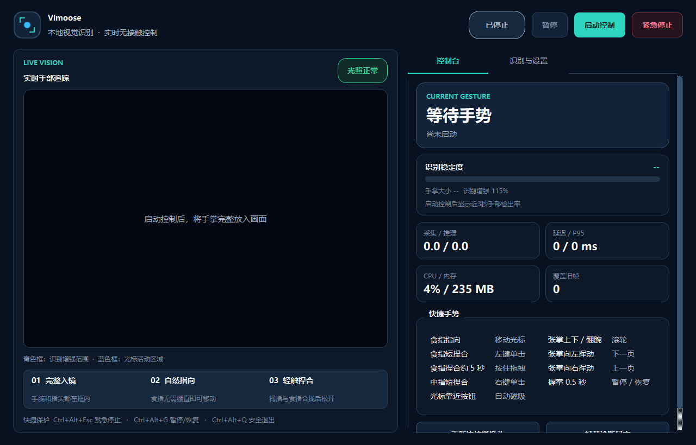

# Vimoose 视觉手势鼠标

## 0.10.0 日常自动文档控制

取消独立课堂入口、教师锁定及课堂校准。日常指向、捏合鼠标始终保留；前台是 Microsoft PowerPoint 放映／编辑窗口或 Word 文档时自动接入张掌翻页／翻屏。
修复捏合接触帧移动光标；过滤面部小骨架，默认关闭单点续跟踪。使用方法和实际验证范围见 [日常使用说明](docs/日常自动文档使用说明.md)、[验收记录](docs/日常模式验收记录.md)。下方旧版本章节仅作历史记录，以本版说明为准。

> 抬起手，就能移动光标、点击、拖拽和滚动。无需专用硬件，也无需上传摄像头画面。

**Vimoose** 由 **Vision + Mouse** 组合而来，是一款面向 Windows 10/11 x64 的开源、离线手势鼠标。它使用普通摄像头和 MediaPipe Hand Landmarker 实时检测单手21个关键点，再通过 Windows `SendInput` 将手势转换为系统级鼠标操作。

与常见的手势演示程序不同，Vimoose 不只追求“能识别”：它加入了时序状态机、防误触、动态平滑、画面安全区全屏映射，以及基于 Windows UI Automation 的控件磁吸，目标是让无接触操作真正接近可日常使用的鼠标体验。

适合智慧展厅、PPT演示、医疗无接触环境、辅助操作，以及计算机视觉与人机交互学习。



## 为什么选择 Vimoose

- **普通摄像头即可使用**：支持笔记本内置摄像头、USB摄像头和常见虚拟摄像头。
- **完全本地运行**：默认不保存、不上传视频、图像或手部关键点。
- **完整鼠标操作**：移动、左键、右键、双击、拖拽、滚轮和翻页。
- **控件磁吸**：靠近关闭、最小化、菜单和浏览器标签关闭按钮时自动对准可点击点。
- **安全优先**：手部丢失、摄像头断开、异常或退出时自动释放鼠标按键。
- **可调节、可校准**：灵敏度、稳定性、全屏覆盖、捏合阈值和磁吸半径均可配置。

## 已实现功能

- 食指控制主显示器光标，支持安全活动区全屏映射、边缘直达和自适应平滑。
- 拇指与食指短捏合松开后左键单击；连续短捏合由Windows识别为双击。
- 食指捏合保持约2秒进入拖拽，松开、越界或丢失手部时强制释放左键。
- 拇指与中指先张开再主动捏合，松开后右键单击。
- 张开手掌上下移动或前后翻腕控制滚轮。
- 张开手掌向左挥动进入下一页，向右挥动返回上一页。
- 握拳保持500ms暂停或恢复。
- 光标靠近Windows可点击控件时自动吸附到按钮落点，不自动触发点击。
- PySide6设置面板、实时关键点预览、系统托盘和用户级开机自启。
- 全局快捷键：
  - `Ctrl+Alt+G`：暂停或恢复。
  - `Ctrl+Alt+Esc`：紧急停止并释放鼠标。
  - `Ctrl+Alt+Q`：安全退出。
- 默认离线处理，不保存或上传画面。

## 0.3 识别与流畅度改进

- MediaPipe已经输出完整手部时，除捏合、握拳和张掌滚动等高优先级手势外，均可直接移动光标；食指自然微弯、侧手或中指半伸不再被拒绝。
- 指尖捏合和手指屈伸改用二维几何量，避免单目深度坐标波动造成漏识别。
- 默认允许任意手，检测/存在/跟踪门槛分别调整为40%/35%/40%，弱光和侧手更容易进入追踪。
- 默认将中央识别区温和放大至115%，提高远手和小手在模型输入中的有效像素；关键点会精确映射回原画面。
- 使用时间感知One Euro滤波：静止时抑制抖动，快速移动时自动提高响应速度。
- 在约20至30fps视觉结果之间生成最高约125Hz的临界阻尼轨迹，目标更新时保留当前速度，不再每个视觉帧刹停后重新起步。
- 暗光画面采用受限Gamma增强；极暗时只增强亮度通道的局部对比度。
- 控制台显示近3秒手部检出率、手掌大小、识别增强倍率、光照和无视频信号提示，并区分手太远、手太近和指尖遮挡。

推荐初始参数：稳定性58%、响应速度82%、丝滑过渡42ms、捏合灵敏度42%、检测门槛40%、识别增强115%。如果手经常靠近画面边缘，可将识别增强调回100%；如果出现背景误检，再逐步提高检测门槛。

## 0.4 点击锁定、翻页与局部单指续跟踪

- 拇指靠近食指或中指、尚未真正接触时即进入“点击位置锁定”，立即取消上一帧尚未完成的光标插值。短捏合结束前光标保持在目标位置。
- 张掌运动按主方向判定：水平挥动触发翻页，垂直移动触发滚轮，两者不会同时执行。
- 向左挥动发送`PageDown`进入下一页，向右挥动发送`PageUp`返回上一页；一次张掌挥动只触发一页，重新张掌后才能再次触发。
- 完整手部部分出框时，前后向Lucas–Kanade光流会继承8号食指和12号中指身份；只要跟踪质量仍合格就持续工作，不再受原来的8帧上限限制。
- 食指局部续跟踪可以继续移动光标；只剩中指时界面会显示“中指续跟踪”，但不会误当作食指移动鼠标。
- 单指续跟踪依赖最近一次完整21点手部结果。程序冷启动时如果画面中始终只有一截孤立手指，缺少掌部和相邻手指上下文，软件不会猜测其身份。

## 0.5 视频反馈修正

- 食指独立伸出、其余手指自然收拢时，即使拇指恰好靠近弯曲的中指，也保持光标移动，不再误报右键或锁住光标。
- 右键加入“先张开、再靠近”的时序门控；只有中指从明确分离状态主动靠近拇指才进入右键捏合。
- 右键意图一旦建立会保持到松开，食指在捏合过程中短暂经过拇指附近不会把右键抢成左键。
- 食指指向状态下前后翻腕仍保持光标移动，使用食指尖位置更新纵向坐标，不再因二维投影缩短误进入握拳暂停。
- 张掌后也可通过掌心前后翻转控制滚轮，无需整只手在画面中平行上下移动；原有平移滚轮仍然保留。
- 翻腕辅助使用掌宽归一化的相对深度，并先于握拳暂停判定；前一帧处于指向还是张掌，决定翻腕继续移动光标还是控制滚轮。

## 0.6 捏合优先级、控件磁吸与全屏可达

- 捏合接触进入手势冲突保护区后，点击/拖拽判定先于握拳确认。侧手或其余手指收拢时，食指捏合不会再被抢成“握拳确认”。
- 中指右键允许从张掌直接建立意图；从张掌进入时要求中指仍保持主动伸出，从而兼顾右键召回率与“收起中指贴近拇指”的防误触。
- 0.7.0历史版本曾把默认拖拽长按从300ms改为5秒；当前默认值已在0.8.0调整为2秒，设置页提供1–8秒调节。
- 默认光标安全活动区调整为横向20%、纵向16%。食指到达安全区边缘时直接覆盖屏幕边缘，无需继续把手移出摄像头。
- 新增“全屏覆盖”调节；数值越大，完成全屏移动所需的手部行程越短。
- 新增Windows控件磁吸：独立线程使用UI Automation探测按钮、复选框、单选框、菜单项和链接，光标进入吸附半径后落到控件的可点击点。
- 磁吸不会自动点击，拖拽期间自动停用；目标程序不提供UI Automation信息或控件瞬间消失时，会无错误地退回普通光标移动。

## 0.7 浏览器标签关闭磁吸与正式发布

- 浏览器标签页背景不再被当作整块磁吸目标，光标不会刚进入标签就被拉回标签中心。
- 当浏览器暴露独立的“关闭标签页”按钮时，Vimoose会优先吸附到叉号的真实可点击点。
- 标签中心与关闭按钮使用独立的激活和释放逻辑，允许光标自然离开标签文字区域并继续靠近叉号。
- 完成从 GesturePilot 到 Vimoose 的品牌升级；旧版个人配置会在首次启动时自动迁移。
- 新增公开仓库说明、MIT许可证、隐私说明、版本化安装包和可复现的发布验证流程。

## 0.8 边缘误触保护与拖拽提速

- 点击、右键、滚轮、翻页和握拳暂停增加关键点画面完整性门控；拇指或手掌越界时，MediaPipe的预测坐标不再触发离散操作。
- 食指仍在画面内时继续保持光标移动，不会因为拇指离开摄像头而跳成左右捏合、滚轮或握拳确认。
- 待定捏合在越界时按“识别证据失效”取消，不把越界误当成松开，因此不会产生一次幽灵点击。
- 越界或手部丢失后，必须连续识别到完整手部约1秒才重新允许点击、滚轮、翻页和握拳；等待期间食指仍可正常移动光标。
- 拖拽中发生越界仍会立即释放左键，保持原有的按键卡死保护。
- 默认拖拽长按从5秒缩短到2秒；0.7.0的默认配置会自动迁移，设置页仍可在1–8秒间调节。

### 0.8.5 右键灵敏度与翻腕准确性

- 右键接触允许中指在120ms内完成前伸，但等待期间立即锁定点击位置，不再输出一帧光标移动。
- 右键要求中指前伸、关节角度和食指伸展同时成立；张掌收成指向、自然收拢中指时不再被长期锁成右键。
- 右键预备仍保留较宽松的侧手距离门槛，避免为了降低误触而牺牲真实侧手右键。
- 指向后缓慢翻腕按多帧累计深度变化判定；即使跨阈值首帧被透视压成捏合形状，也优先保持旋转，不触发左右键。
- 翻腕投影保护只锁存由指向姿势开始的旋转，不会吞掉普通张掌后的真实中指右键。

### 个性化三步校准

在“识别与设置”中点击“运行三步个性化校准”，依次采集：

1. 拇指与食指自然张开；
2. 按平时力度轻轻捏合；
3. 食指自然指向并尽量保持不动。

校准期间会自动暂停鼠标注入，但继续在本机进行低频识别。软件会根据用户实际开合距离计算捏合滞回阈值，并根据静止指尖抖动调整稳定性、响应速度和丝滑过渡时间。只有点击“应用校准”后才会保存，取消不会修改现有参数。

0.8.2起，校准和运行时统一使用掌宽与掌长组合的稳健尺度。0.8.1及更早版本保存的过高捏合阈值会在首次启动时安全迁移，避免自然指向被误判为点击待定。

## 开发环境

项目固定使用 Python 3.11，避免不同Python版本对MediaPipe二进制包兼容性的影响。

```powershell
py -3.11 -m venv .venv
.\.venv\Scripts\python.exe -m pip install --upgrade pip
.\.venv\Scripts\python.exe -m pip install -e ".[dev]"
.\scripts\download_model.ps1
```

安全模式不会向系统注入鼠标事件，适合首次检查摄像头和界面：

```powershell
.\.venv\Scripts\python.exe -m gesture_mouse --safe-mode
```

确认预览、手势和紧急快捷键正常后再启动正式控制：

```powershell
.\.venv\Scripts\python.exe -m gesture_mouse
```

自动化摄像头/模型诊断使用空鼠标后端，运行指定秒数后安全退出：

```powershell
.\.venv\Scripts\python.exe -m gesture_mouse --minimized --diagnostic-seconds 10
```

## 自动化测试

```powershell
.\.venv\Scripts\python.exe -m pytest
```

测试使用合成关键点和空鼠标后端，不会真实移动或点击系统鼠标。

## 构建与安装器

执行完整构建：

```powershell
.\scripts\build.ps1
```

生成的目录包位于 `dist\Vimoose`。安装 Inno Setup 后，编译 `packaging\Vimoose.iss` 可生成当前用户级安装器。

## 产品边界

- 首版只支持单摄像头、单手和主显示器。
- 程序以普通权限运行时，不能向管理员权限窗口注入鼠标事件。
- 控件磁吸依赖目标程序公开Windows UI Automation信息；游戏画面、自绘Canvas和部分旧软件可能只能使用普通光标。
- 摄像头画面之外不存在可供模型恢复的像素；本版通过安全区全屏映射和边缘直达避免必须把手移出画面。
- 多显示器、双手、自定义手势、语音和跨平台不属于首版范围。
- 项目中的性能门槛必须在记录了CPU、内存、摄像头和显示缩放的参考机器上验收。

## 配置与日志

- 配置：`%LOCALAPPDATA%\Vimoose\config.json`
- 日志：`%LOCALAPPDATA%\Vimoose\logs\vimoose.log`

Vimoose首次启动时会自动读取并迁移 `%LOCALAPPDATA%\GesturePilot\config.json`，旧版个性化设置不会丢失。

退出或卸载默认不会删除个人配置，方便后续升级沿用。需要完全重置时，可在设置页使用“恢复默认”。

## 识别不到时先检查

1. 控制台显示“无画面信号”时，模型实际上没有收到有效视频。使用Iriun或OBS虚拟摄像头时，应先启动视频源；否则到“识别与设置”切换摄像头编号。
2. 保证手腕和全部指尖进入青色识别框；蓝色框是光标活动区域。控制台会根据手掌在画面中的大小提示靠近或后退。
3. 避免摄像头正对窗户或灯光；界面提示“光线偏暗”时应优先改善照明。
4. 操作手建议保留“任意手（推荐）”；只有需要排除另一只手时才锁定左右手。
5. 点击动作采用“捏合后松开”触发，默认持续捏合约2秒才转换为拖拽。
6. 翻页使用张掌水平挥动；手部部分出框时，先让完整手掌被识别一次，软件才能继承单指身份。

## 开源与参与

Vimoose 使用 [MIT License](LICENSE) 发布。问题反馈和改进建议请提交到 [GitHub Issues](https://github.com/KIdiens/Vimoose/issues)。

- 隐私说明：[PRIVACY.md](PRIVACY.md)
- 第三方组件与许可证：[THIRD_PARTY_NOTICES.md](THIRD_PARTY_NOTICES.md)
- 性能基线与尚未完成的正式验收项：[PERFORMANCE_BASELINE.md](PERFORMANCE_BASELINE.md)
